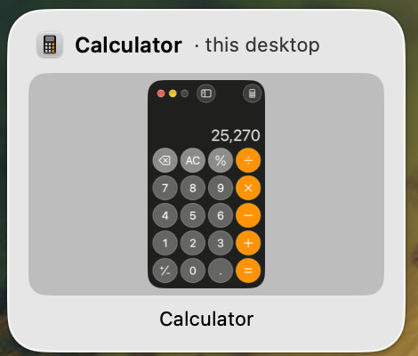
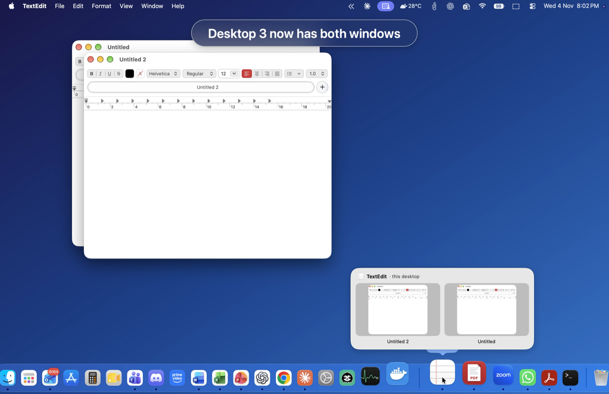

<p align="center">
  
</p>

<h1 align="center">SpaceKeeper</h1>

<p align="center"><b>Make every macOS desktop its own workspace.</b><br>
A free, open-source menu-bar app for macOS Spaces.</p>

<p align="center">
  <a href="https://github.com/techmalik/SpaceKeeper/actions/workflows/build.yml"></a>
  <a href="LICENSE"></a>
  
</p>

---

macOS lets you have many desktops, but apps don't really *live* on them: click an app in the Dock and you get
yanked to whichever desktop it was last on, Dock previews mix windows from every desktop, and there's no quick way to
park a window on another desktop. SpaceKeeper fixes that.

<p align="center"></p>

<p align="center">
  <a href="https://github.com/techmalik/SpaceKeeper/releases/download/v1.0.0/SpaceKeeper-demo.mp4">
    
  </a><br>
  <b>▶ <a href="https://github.com/techmalik/SpaceKeeper/releases/download/v1.0.0/SpaceKeeper-demo.mp4">Watch the 90-second demo</a></b>
</p>

## Features

| | |
|---|---|
| **Send windows to other desktops** | `⌃⌥⌘ 1–9` sends the front window to Desktop N, `⌃⌥⌘ ←/→` to the previous/next one — or use the menu-bar menu. The window stays there. |
| **Per-desktop Dock previews** | Hover an app in the Dock and see live thumbnails of *only that app's windows on the current desktop* (minimized ones too). Hover a thumbnail for **close** and **minimize** buttons; click it to bring the window forward. |
| **Click the Dock icon to minimize** | Click the icon of the frontmost app and its windows on this desktop minimize. Click again and they come back. |
| **No more desktop-jumping** | Click an app that has no window on this desktop and SpaceKeeper opens a new window *right here* instead of pulling you to another desktop. Minimized windows are restored in place. |
| **Stays out of your way** | Lives in the menu bar, no Dock icon, no network access, no telemetry. Dragging Dock icons to reorder still works. |

## Install

1. Download **`SpaceKeeper-x.y.z.dmg`** (or the `.zip`) from the [latest release](https://github.com/techmalik/SpaceKeeper/releases/latest).
2. Open it and drag **SpaceKeeper** into **Applications**.
3. **First launch:** SpaceKeeper isn't notarized by Apple (that needs a paid developer account), so macOS will say it
   can't verify the app. Open **System Settings → Privacy & Security**, scroll down and click **Open Anyway**.
   Or, from Terminal:
   ```bash
   xattr -dr com.apple.quarantine /Applications/SpaceKeeper.app
   ```
4. Grant the two permissions it asks for (see below). That's it — look for the icon in your menu bar.

Prefer to build it yourself? See [Build from source](#build-from-source).

### Permissions (and why)

| Permission | Why | Where |
|---|---|---|
| **Accessibility** *(required)* | Read and move windows, see which Dock icon is under the pointer, minimize/restore, and post the keystrokes that move a window between desktops. | System Settings → Privacy & Security → Accessibility |
| **Screen Recording** *(for previews)* | Draw the live window thumbnails. Without it you still get previews, just with app icons instead of content. | System Settings → Privacy & Security → Screen Recording |

SpaceKeeper never records, stores or sends your screen. Thumbnails are drawn in memory and discarded.

### Recommended setting

On first launch SpaceKeeper offers to turn off macOS's *"When switching to an application, switch to a Space with
open windows for the application"* option (also in the menu as **Don't jump to other desktops when opening apps**).
SpaceKeeper's Dock handling works either way, but turning this off makes everything feel consistent.

## Using it

- **Move a window:** focus it, press `⌃⌥⌘ 2` (to Desktop 2) — or menu bar → **Send Front Window To**.
  Takes about a second per desktop crossed. Turn on **Follow window to its new desktop** if you'd rather travel with it.
- **Previews:** just hover an app in the Dock.
- **Minimize / restore / new window:** click the app's Dock icon.
- Everything can be switched on or off from the menu-bar icon. **About SpaceKeeper** has the version and contact details.

## How moving windows works

macOS 14.5+ silently ignores the private "move window to Space" call for ordinary apps. So SpaceKeeper does what you
would do by hand: it grabs the window's title bar, presses the Mission Control shortcut (`⌃←` / `⌃→`) to travel to the
target desktop while holding the window, and lets go. Before it starts it checks that the window is on top and actually
follows the pointer, and afterwards it verifies where the window ended up. See [docs/architecture.md](docs/architecture.md).

This relies on Mission Control's **Move left/right a space** shortcuts being enabled (they are by default).

## Known limitations

- **Dock "running" dots** are drawn by the Dock itself and can't be made per-desktop.
- **Single-window apps** with no "New Window" menu item (e.g. WhatsApp) can't open a second window; for those the
  normal macOS behavior (jump to the app's window) is kept.
- Windows set to **Assign to: All Desktops** can't be sent to a single desktop.
- The Dock must be at the bottom, left or right of the screen; auto-hidden Docks are not specifically supported yet.
- Uses a few **private macOS APIs** (read-only Space lookups), so it can't be distributed on the Mac App Store and a
  future macOS release could break it.
- Developed and tested on **macOS 27 (Apple Silicon)**. The binary is universal and targets macOS 14+, but older macOS
  versions and Intel Macs are untested — reports welcome!

## Troubleshooting

- **Nothing happens / hotkeys do nothing:** check *Accessibility* is on for SpaceKeeper, then quit and reopen it.
- **"⚠︎" appears in the menu bar after a move:** the menu shows the reason (e.g. another window covers the title bar).
- **Duplicate preview cards:** another Dock-preview tool (iDock, DockDoor…) is running; the menu offers to quit it.
- **Permissions reset after an update:** remove SpaceKeeper from the Accessibility list, add it back, relaunch.

## Build from source

Requires the Xcode Command Line Tools (`xcode-select --install`) — full Xcode is not needed.

```bash
git clone https://github.com/techmalik/SpaceKeeper.git
cd SpaceKeeper
./scripts/build.sh --install     # builds a universal app and copies it to ~/Applications
open ~/Applications/SpaceKeeper.app
```

`./scripts/package.sh` produces the `.zip`/`.dmg` release assets in `dist/`.
To use your own logo see [docs/LOGO_PROMPT.md](docs/LOGO_PROMPT.md).

## Contributing

Bug reports, ideas and pull requests are very welcome — see [CONTRIBUTING.md](CONTRIBUTING.md).

## Author

Made by **Malik Kabir** — questions, feedback or ideas: [techmaleek@gmail.com](mailto:techmaleek@gmail.com).

## License

[MIT](LICENSE) © 2026 Malik Kabir
